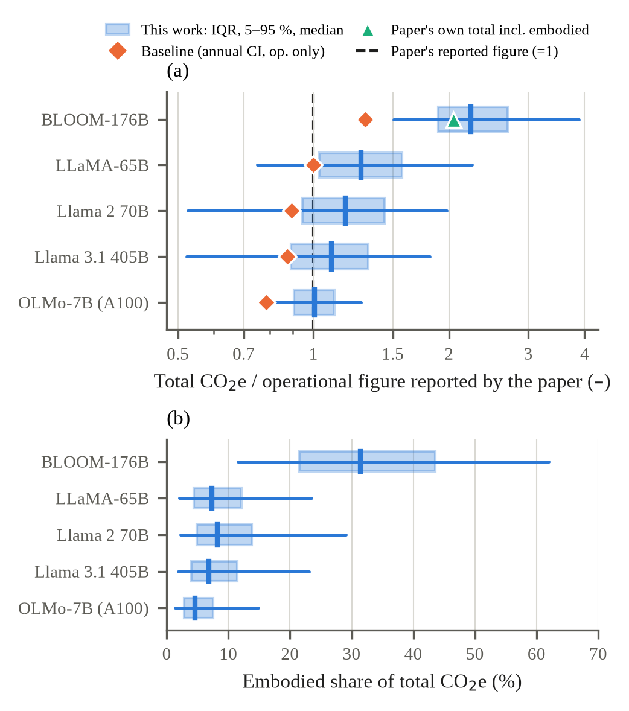
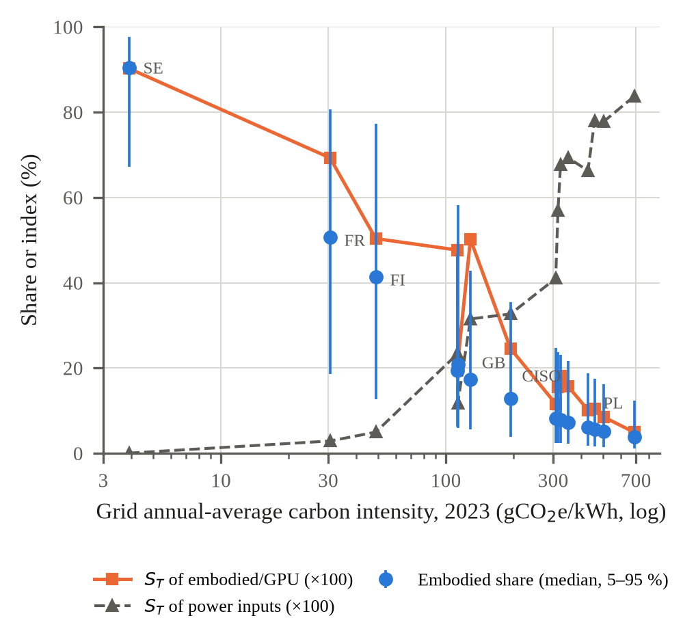

# How Uncertain Is the Carbon Footprint of LLM Training?

**Embodied-plus-operational carbon accounting with hourly grid data and Sobol variance decomposition**

Published carbon footprints of large-language-model training are single numbers: operational
electricity only, converted with an annual-average grid intensity. This project re-estimates five
publicly disclosed training runs — **BLOOM-176B, LLaMA-65B, Llama 2 70B, Llama 3.1 405B and OLMo-7B**
— as probability distributions, adds embodied (manufacturing) carbon, uses real **hourly** grid
carbon-intensity data instead of annual averages, and asks which uncertain input actually controls
the answer.

📄 **Paper:** [`paper/paper.pdf`](paper/paper.pdf) (IEEE conference format, 6 pages)

---

## Key findings

| Run | Median total (tCO₂e) | 90 % interval | Standard-practice baseline | Reported by authors |
|---|---|---|---|---|
| BLOOM-176B | 55.2 | 37.2 – 95.5 | 32.2 | 24.69 |
| LLaMA-65B | 220.5 | 129.1 – 387.8 | 172.8 | 173 |
| Llama 2 70B | 344.0 | 153.4 – 576.8 | 260.2 | 291.42 |
| Llama 3.1 405B | 9,794 | 4,659 – 16,257 | 7,809 | 8,930 |
| OLMo-7B | 70.3 | 55.3 – 89.4 | 54.9 | 70 |

- Medians sit **1.25–1.72×** above the standard-practice baseline; honest 90 % intervals span **1.6–3.8×**.
- Only BLOOM's headline figure falls outside its own honest interval; the other four reported
  figures lie inside theirs.
- **What dominates the uncertainty depends on the grid:** undisclosed training location explains
  71 % of the variance for the Meta runs, while embodied carbon per GPU explains 81 % for BLOOM on
  France's low-carbon grid. Below roughly 130–190 gCO₂e/kWh, embodied carbon becomes the main
  source of uncertainty.
- Annual-average grid intensity overstated the intensity BLOOM actually trained under by 14.6 %.

<p align="center">
  
  &nbsp;
  
</p>

---

## Quick start

Requires **Python 3.11+**. No GPU; about one minute on a laptop.

**Windows:** double-click `run_all.bat`
**macOS / Linux:** `bash run_all.sh`

Or step by step:

```bash
python -m venv .venv
# Windows: .venv\Scripts\activate        macOS/Linux: source .venv/bin/activate
pip install -r requirements.txt
python src/experiments.py all     # Monte Carlo, Sobol, hourly analysis, zone sweep  -> results/
python src/figures.py             # Figs. 1–5                                          -> figures/
python src/report.py              # every number in the paper                          -> results/RESULTS.md
```

All randomness is seeded (`SEEDS = [0, 1, 2]` in `src/config.py`), so reruns reproduce the numbers
above exactly. Single experiments: `python src/experiments.py mc | sobol | hourly | sweep | extras`.

---

## Repository structure

```
├── paper/paper.pdf        the paper
├── src/
│   ├── config.py          disclosed run data (with sources) and all priors
│   ├── ci_data.py         hourly carbon-intensity loader with O(1) window means
│   ├── model.py           the model: equations (1)–(7) of the paper
│   ├── experiments.py     Monte Carlo, Sobol, hourly-vs-annual, zone sweep, checks
│   ├── figures.py         Figs. 1–5
│   └── report.py          results/RESULTS.md
├── data/
│   ├── README.md          data provenance and licence
│   └── raw/               hourly carbon intensity for 23 grid zones, 2021–2024
├── results/               reference outputs (CSV, JSON, RESULTS.md)
├── figures/               reference figures (PDF, PNG)
├── docs/                  reproducibility sheet (versions, seeds, hardware, runtimes)
├── run_all.bat / run_all.sh
└── requirements.txt
```

## Method

For each run, uncertain inputs — grid region, start time, GPU power draw, host power, PUE,
embodied carbon per accelerator, hardware lifetime and utilisation — are sampled from the priors
in `src/config.py` and propagated through:

```
t      = G / N                                   run duration
E_IT   = G · P_TDP · (ρ + η)   or   E_meas · m   IT energy
CI_eff = mean of hourly CI_z(h) over [s, s + t)  effective grid intensity
C_op   = E_IT · PUE · CI_eff                     operational emissions
C_emb  = G · c_emb / (8760 · L · u)              amortised embodied emissions
C_tot  = C_op + C_emb
```

Monte Carlo uses 10⁵ samples × 3 seeds per run; variance is decomposed with first- and
total-order Sobol indices (SALib, N = 2¹⁴). The standard-practice baseline uses TDP power, a
nominal PUE, annual-average intensity and no embodied term.

## Data

Hourly grid carbon intensity © [Electricity Maps](https://www.electricitymaps.com) (ODbL),
obtained from the [CarbonX](https://github.com/codecexp/CarbonX) repository. Training-run
disclosures are taken from the original papers and model cards; see `data/README.md` and
`src/config.py` for every source.

## Author

**Vedant Shah** — B.Tech Artificial Intelligence & Machine Learning, Atlas SkillTech University, Mumbai.
Developed as the End Term research project for *Next Generation Computing* (Semester VII).

## License

Code: MIT (see `LICENSE`). Data: ODbL, © Electricity Maps.
